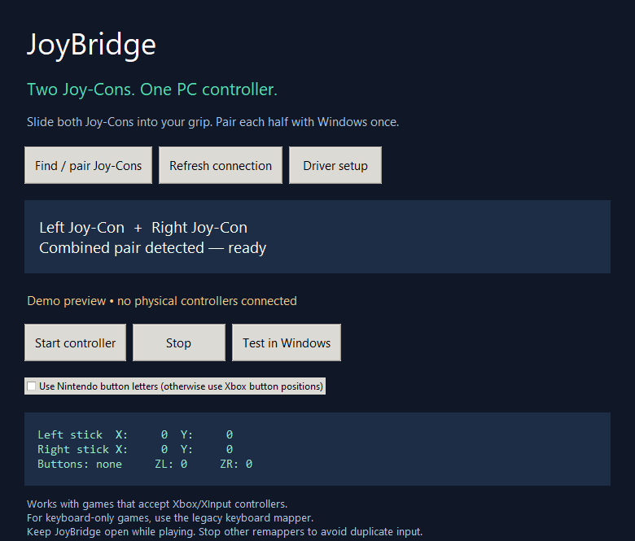

# JoyBridge — PC Gaming

Use your original Nintendo Switch Joy-Con (L) and (R) together in a grip as **one virtual Xbox 360 controller** on Windows x64.

The current focus is PC gaming. Android and dance experiments are historical and are not required. The grip holds the halves physically; each Joy-Con still connects separately over Bluetooth.

**Experimental:** executable builds and UI checks are automated. Physical Joy-Con pairing, combined SDL input and real-game output have not yet been verified on Windows hardware. No universal game compatibility claim is made.

## Download

Open [Build PC gaming app](https://github.com/Sam4d/JoyBridge/actions/workflows/gaming.yml), select a successful run, and download **JoyBridge-Gaming-Setup**. Extract the ZIP and run **JoyBridge-Gaming-Setup.exe**. A portable **JoyBridge-Gaming.exe** is available in the other artifact. No Python or Android installation is needed. Builds are unsigned; Actions artifacts require GitHub sign-in and expire.

## Connect and play

1. Install JoyBridge and open its desktop shortcut.
2. Choose **Driver setup** for the official ViGEmBus download page. Install that driver if not already present; Windows asks for administrator approval and may require a restart. Reopen JoyBridge afterward.
3. Choose **Find / pair Joy-Cons**. Hold the small SYNC button on the left half until its lights chase; add **Joy-Con (L)** in Windows Bluetooth settings. Repeat for **Joy-Con (R)**.
4. Choose **Refresh connection**. The app waits for SDL's combined **L/R** device; one half alone cannot start Xbox output. Connect only your one grip pair.
5. Choose **Start controller**, then **Test in Windows**. Look for an Xbox 360 controller and check both sticks/buttons. Start your game afterward and choose its controller input mode.
6. Keep JoyBridge open while playing. **Stop** releases and removes its virtual controller. Disconnecting the pair stops output; reconnect, refresh and explicitly start again.

The pair selection deliberately accepts exactly one combined SDL L/R device. It never merges arbitrary devices or sends every connected pair to the same output. Independent multiplayer slots are not implemented.

## UI

*Actual Windows UI captured in demo mode; cropped to omit the CI desktop. No physical controller connection is implied.*

The app has pairing guidance, connection status, driver setup, start/stop, Windows controller testing, button-layout selection, and a live input display. The screenshot generated by the Windows build shows **demo state**, not proof of real connected hardware.

## Buttons

| Joy-Con input | Xbox output |
| --- | --- |
| Left / right stick | Left / right analog stick |
| Stick clicks | LS / RS |
| Direction buttons | D-pad |
| L / R | LB / RB |
| ZL / ZR | LT / RT, digital 0 or 255 |
| Minus / Plus | Back / Start |
| Home | Guide (game/system handling varies) |
| B / A / Y / X | A / B / X / Y by physical position |

Choose **Use Nintendo button letters** to map A→A, B→B, X→X, Y→Y instead. Stick deadzone is approximately 15%; analog range is retained outside it. Joy-Cons have no pressure-sensitive triggers. SL/SR/Capture are not mapped. Gyro aiming and rumble forwarding are not implemented.

## Game use cases

| Use case | Setup and limitation |
| --- | --- |
| Platformers and action games | Xbox output, position layout; select gamepad in game settings |
| Racing | Both sticks and digital triggers; no variable trigger pressure |
| Sports and local solo play | One Xbox controller slot; multiplayer assignment not implemented |
| Steam games | Avoid running another mapper for the same Joy-Cons; adjust per-game Steam Input if you see duplicate controls |
| Non-Steam / standalone / Game Pass | Xbox output works independently of Steam in principle; each game and launcher still needs validation |
| Keyboard-only games | Use the [legacy keyboard mapper](src/main.c); the new gaming app does not translate buttons to keys |

Some games can see both physical Joy-Cons and the virtual Xbox pad. Automatic physical-device hiding is not included; HidHide is an optional separate tool requiring careful device selection. Do not run competing remappers concurrently. Game rules, anti-cheat and controller support can affect compatibility. No games are labeled hardware-tested yet.

## Driver and dependencies

Xbox output uses [vgamepad](https://github.com/yannbouteiller/vgamepad) and [ViGEmBus](https://github.com/nefarius/ViGEmBus). **ViGEmBus is retired and no longer maintained.** This dependency is a limitation of the experimental implementation; no maintained successor is bundled or claimed. Download only from its official repository. Driver installation is explicit, not silently performed. SDL2 2.32.10 handles Joy-Con input and pair combination. Third-party code retains its licenses; the build collects vgamepad package data and SDL notices.

## Build and validation

The [gaming workflow](.github/workflows/gaming.yml) packages the Windows x64 executable with Python 3.12, PyInstaller, vgamepad and checksum-pinned SDL. It tests stick neutral/range behavior and opens the actual UI in demo mode to capture a screenshot. An Ubuntu job creates the per-user NSIS installer.

Manual release gate: pair both halves, verify SDL combined detection, test every Xbox input in `joy.cpl`, play one game from each intended launcher, disconnect either half while moving, reconnect, and check for duplicate inputs. These hardware checks remain pending. Successful builds do not establish device or game compatibility.

See [gaming source](gaming/app.py), [legacy mapper](src/main.c), and [earlier product research](docs/PRODUCT_BLUEPRINT.md). Earlier architecture and roadmap documents describe proposals, not current gaming features.
