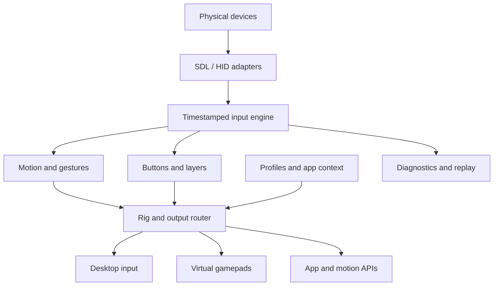

# Architecture and migration

**Proposed target architecture.** Current runtime is a single C/Win32/SDL2 application in `src/main.c`. No new engine, plugin, motion or routing implementation is implied by this design.

## Boundaries

Use a portable C++ core as the initial candidate because SDL and existing sensor-fusion helpers fit it naturally. Keep its public boundary small and independent of window handles. Evaluate UI choices after a runnable headless engine exists; a cross-platform UI toolkit must meet accessibility, packaging and license requirements. Do not rewrite the acquisition engine merely to change the UI framework.

SDL3 is the target adapter candidate; retain SDL2 for the historical prototype until the migration is tested. Explicit device enumeration, per-hand sensor data and application-managed pairing/rig assignments are requirements. Do not assume that enabling automatic SDL Joy-Con combination solves deliberate player assignment. Test a separate-device mode with stable physical identities.

## Engine contracts

- `DeviceSample`: logical local device ID, connection epoch, monotonic sensor/host timestamps, button bits, axes, gyro radians/s, acceleration m/s², capability bits and validity flags.
- `Rig`: role bindings to physical devices, orientation/grip settings and output routes.
- `Action`: desired button/axis/relative-pointer/gesture output tagged with source and profile generation.
- `OutputSink`: apply, neutralize, flush and health methods; its backend declares capacity and supported features.
- `Plugin`: versioned request/event contract with explicit permissions and backpressure; the engine never waits for a slow network/plugin operation.
- `Profile`: versioned declarative mappings and app rules, referencing roles rather than private physical identifiers.

Use bounded queues. Coalesce replaceable pointer/axis values but preserve discrete button edges; overflow should neutralize affected outputs and report a fault rather than leave a held key. Use measured dt, cap stale integration gaps and reset state across connection epochs. A stopped consumer must not block another player's input.

## Platform/output adapters

| Platform | Candidate path | Work required |
| --- | --- | --- |
| Windows desktop | SendInput keyboard/mouse | Track failed sends, focus/integrity limits, modifiers, pause and crash recovery |
| Windows gamepad | Separately selected virtual-device backend | Driver maintenance/signing/distribution, game compatibility, input hiding and rumble loop |
| Linux | SDL input; uinput/libevdev where appropriate | Device permissions, distributions, desktop-specific routing and hotkeys [S14] |
| Linux Wayland | libei/portal where supported | Consent, compositor/portal capability matrix and fallback disclosure [S15] |
| macOS | SDL/native input plus permitted event injection | Accessibility permissions, signing/notarization, background input and virtual-output research |
| Cross-platform apps | MIDI, OSC, DSU, named app API | Version/units/capacity tests, clear endpoint selection, permission model |

The archived ViGEmBus project is a dependency risk, not a foundation to silently bundle [S11]. Select a maintained and distributable approach through an explicit evaluation. A generic virtual HID joystick is not automatically an Xbox controller. Controller hiding is a separate conflict-management problem. Do not ship a kernel driver or ask users to disable protections as a routine workaround.

## Profile design

Versioned data-only profile with fields for metadata/status, role requirements, output backend, app matcher, controls/layers, motion mode, gain units, calibration reference, gestures, and compatibility evidence. Strict type/range checks and explicit migrations. Imported profiles cannot execute scripts, install plugins, write controller flash or open remote connections by themselves.

Match rules should target a selected executable or named adapter connection. Profile changes cancel pending gestures, release outputs and reset accumulators before reactivation. A profile lock prevents unwanted switching. Settings writes must be atomic and failures visible; the prototype currently does not check every persistence result.

## Observability and resilience

Display device/rig/output as separate statuses. Record local timing histograms and failure counters. A diagnostic export is opt-in, previews included fields and redacts addresses, usernames, paths and credentials. Recording/replay of sensor traces is local by default; raw traces can reveal activity and should not be automatically uploaded.

Global pause is independent of plugin state. Enforce one engine per user session. A future watchdog should release/neutralize outputs after a process failure; ordinary `WM_DESTROY` cleanup cannot run after every crash. Suspend, lock, focus changes, device loss and profile swaps require explicit transitions.

## Migration order

1. Preserve v0.1 as an experimental baseline and add repeatable builds/status docs.
2. Extract input/output state handling into a platform-neutral core with regression tests.
3. Add device lifecycle/identity and a sensor recorder, without live motion output.
4. Integrate calibrated gyro mouse for one hand with replay and hardware tests.
5. Add deliberate multi-device roles, profiles and supported output backends.
6. Add app adapters and only then the cross-platform UI/runtime ports.

Do not let an attractive dashboard hide a missing motion engine or nonexistent virtual driver.
